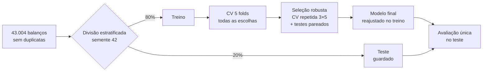

# Previsão de falência de empresas polonesas: alerta precoce com regressão logística e MLP

Projeto da disciplina de Deep Learning (Pós-Graduação em Estatística). Base: **Polish Companies Bankruptcy**
(UCI, id 365): 43.405 balanços de empresas polonesas, 64 indicadores financeiros, distribuídos em 5 arquivos.

**Tarefa:** estimar a probabilidade de uma empresa falir dentro de um horizonte de *h* anos (*h* = 1 a 5), comparando
uma regressão logística (baseline) com uma rede neural MLP.

Relatório do pipeline e dos testes estatísticos, passo a passo: [`docs/relatorio_pipeline_e_testes.md`](docs/relatorio_pipeline_e_testes.md)

---

## Os notebooks

Rode na ordem. Cada um salva em `resultados/` o que o seguinte usa.

| # | Notebook | O que faz | Saídas principais |
|---|---|---|---|
| 01 | [`01_leitura_dados.ipynb`](01_leitura_dados.ipynb) | Leitura dos 5 arquivos ARFF, duplicatas, montagem do alvo, dicionário das 64 variáveis | — |
| 02 | [`02_eda_estabilidade.ipynb`](02_eda_estabilidade.ipynb) | Análise exploratória: faltantes, caudas, poder discriminante, correlação, estabilidade entre arquivos (PSI, KS) e **falidas que pareciam saudáveis** | `resumo_variaveis.csv` |
| 03 | [`03_regressao_logistica.ipynb`](03_regressao_logistica.ipynb) | Baseline: fatorial de pré-processamento (32 combinações), busca de *C* e penalidade, **seleção robusta** (CV repetida 3 × 5 + testes pareados), modelo final | `prev_logistica.npz`, `config_03.json` |
| 04 | [`04_mlp.ipynb`](04_mlp.ipynb) | MLP: pré-processamento, busca de hiperparâmetros, treino longo (até 5.000 épocas, agendas da taxa, regularização), **seleção robusta** (5 sementes × CV repetida 3 × 5 + testes pareados), modelo final | `prev_mlp.npz`, `config_04.json` |
| 05 | [`05_comparacao_final.ipynb`](05_comparacao_final.ipynb) | Única avaliação no teste: tabelas treino/validação/teste, curvas ROC e PR, **testes estatísticos** (bootstrap, permutação, DeLong, McNemar, t corrigido, Holm), matrizes de confusão, calibração, "quando a MLP falha?", custo | `testes_estatisticos_*.csv`, `calibracao.csv`, … |
| 06 | [`06_alerta_horizonte_vies_tempo.ipynb`](06_alerta_horizonte_vies_tempo.ipynb) | Alerta precoce "falir em até *h* anos" e verificação de viés de tempo | `alerta_horizonte.csv`, … |

**Todo o código está nos notebooks.** Os notebooks 03 a 06 começam com uma seção "Funções do projeto", com o que
cada um usa:

- **dados, pré-processamento e métricas** (03 a 06): leitura (baixa os dados da UCI se faltarem), divisão
  treino/teste, folds da CV (inclusive repetida), pipelines, métricas;
- **rede neural** (04): arquitetura da MLP, laço de treino, validação cruzada em paralelo na GPU e cache em disco;
- **testes estatísticos** (03, 04 e 05): t corrigido de Nadeau-Bengio, *bootstrap* e permutação pareados, DeLong,
  McNemar, Holm.

As funções se repetem de um notebook para outro de propósito: cada notebook roda sozinho, só precisa dos arquivos
que os anteriores salvam em `resultados/`.

---

## Como lidamos com o problema

### 1. Formulação: um alvo multiclasse a partir de 5 arquivos

Cada arquivo `kyear.arff` traz balanços tirados **6 − k anos antes** do desfecho: para uma empresa que faliu no ano
*T*, o `5year` tem o balanço de *T* − 1, o `4year` o de *T* − 2, e assim por diante. Os arquivos são **distâncias até a
falência**, não anos do calendário. Empilhamos os cinco e definimos:

| classe | significado |
|---|---|
| 0 | não faliu no período observado |
| *h* = 1, …, 5 | faliu *h* anos depois do balanço |

Os modelos devolvem $P(y = h)$ para cada classe. Daí saem as três perguntas do projeto:

- **ano exato**: $P(y = h)$ (cada ano contra o resto; critério de escolha = PR-AUC média dos anos 1 a 5);
- **faliu ou não**: $1 - P(y = 0)$;
- **alerta em até *h* anos** (a tarefa do enunciado): $P(y = 1) + \dots + P(y = h)$, sem treinar outro modelo.

O arquivo de origem **não** entra como variável: para as falidas, ele determina a classe (seria vazamento).

### 2. Protocolo de avaliação (sem vazamento)

- Todo o pré-processamento (quantis, imputação, filtro de correlação + VIF, PCA, SMOTE) fica dentro de um *Pipeline*
  ajustado **só nos folds de treino** de cada rodada.
- O teste é usado **uma única vez**, no notebook 05.

### 3. Os desafios dos dados e o que fizemos com cada um

| Desafio | O que fizemos |
|---|---|
| **Desbalanceamento** (4,8% de falidas; 0,6% a 1,2% em cada ano exato) | Métricas para classes raras: PR-AUC (a linha de base é a prevalência, não 0,5), recall a 5% de falsos positivos. Pesos de classe, oversampling e SMOTE foram testados, e as probabilidades corrigidas de volta para a frequência real (correção de *priors*). O melhor foi **não reamostrar** |
| **Caudas extremas** (curtose na casa de 10⁴, razões com denominador perto de zero) | Comparamos padronização, escala robusta, winsorização e **transformação por quantis para a normal**, que venceu nos dois modelos |
| **Faltantes** (X37 com 44%; X27 e X21 informativos) | X37 descartado; os demais imputados pela mediana do treino. Por decisão do projeto, **nenhuma variável nova** (sem indicadores de faltante) |
| **Colinearidade** (10 grupos com \|ρ\| ≥ 0,95) | Redução obrigatória com cortes fixos: Pearson (\|r\| > 0,8) + VIF (< 5), ou PCA com 95% da variância; a CV escolhe |
| **Ruído na escolha do modelo** (diferenças pequenas entre configurações) | Seleção robusta: média de sementes, CV repetida e testes pareados (abaixo) |
| **Censura** (ativas só "não faliram até agora") e **mesma empresa em vários arquivos** (sem identificador) | Não há como corrigir com estes dados; ficam como limitações declaradas |

### 4. Modelos

- **Regressão logística multinomial** regularizada (L1 ou L2).
- **MLP** em funil (camadas densas → *batch normalization* → ReLU → *dropout*, saída *softmax* com 6 classes),
  AdamW, validação interna de 15% do treino para escolher a melhor época, média de 5 sementes. Testamos de 100 a
  5.000 épocas, agendas da taxa de aprendizado (platô, constante, cosseno) e regularização mais forte.

### 5. Como escolhemos o melhor resultado: testes estatísticos

Diferenças de 0,005 na PR-AUC entre configurações estão dentro do ruído de uma única divisão de 5 folds e de uma
única semente. Por isso a escolha final de cada modelo tem duas etapas:

1. **Seleção robusta** (notebooks 03 e 04): os melhores candidatos são reavaliados com **CV repetida 3 × 5**
   (15 folds, 3 divisões diferentes) e, na MLP, **média de 5 sementes**. Vence a maior PR-AUC média nos 15 folds.
2. **Testes pareados** contra o vencedor, com correção de **Holm** para comparações múltiplas:
   - **t corrigido de Nadeau e Bengio** nas 15 diferenças por fold (corrige a dependência entre folds que
     compartilham treino);
   - ***bootstrap* pareado por empresa** nas previsões fora da amostra.

Na comparação final entre MLP e logística (notebook 05), no teste e na CV repetida:

| Métrica | Teste |
|---|---|
| PR-AUC (por ano e "faliu") | *bootstrap* pareado estratificado e **permutação pareada** |
| ROC-AUC | **DeLong** (AUCs correlacionadas) |
| Recall a 5% de falsos positivos | **McNemar** exato |
| Métricas na CV repetida | **t corrigido de Nadeau-Bengio** |

A explicação de cada teste, com fórmulas e interpretação, está no
[relatório](docs/relatorio_pipeline_e_testes.md).

---

## Resultados

Modelos escolhidos pela seleção robusta (os dois com quantis para a normal, correlação + VIF e sem reamostragem):

- **Regressão logística:** L1, C = 0,0545, 24–25 indicadores.
- **MLP:** 2 camadas (128 → 64), *dropout* 0,40, agenda cosseno com 2.000 épocas, média de 5 sementes
  (12.230 parâmetros).

**Teste** (8.601 balanços, 417 falências; avaliado uma única vez):

| Métrica | Logística | MLP | Referência (acaso) |
|---|---|---|---|
| PR-AUC "faliu ou não" | 0,208 | **0,576** | 0,048 |
| ROC-AUC "faliu ou não" | 0,780 | **0,922** | 0,5 |
| Recall a 5% de falsos positivos | 29% | **58%** | 5% |
| PR-AUC média do ano exato (anos 1–5) | 0,052 | **0,132** | 0,010 |
| Brier "faliu em até 5 anos" | 0,042 | **0,030** | 0,046 |

**Alerta em até *h* anos** (PR-AUC no teste): MLP 0,16 / 0,29 / 0,39 / 0,48 / 0,58 para *h* = 1 a 5; logística
0,10 / 0,14 / 0,16 / 0,19 / 0,21.

**Testes estatísticos**
- **No teste:** a MLP é significativamente melhor em "faliu ou não" pelos quatro testes (*bootstrap*, permutação,
  DeLong, McNemar; p de Holm < 0,01).
  - Anos 2, 3 e 4: significativa pelo *bootstrap*, pela permutação e pelo DeLong.
  - Ano 1 (82 falências): significativa só pelo DeLong.
  - Ano 5 (54 falências): significativa pelo *bootstrap* e pelo DeLong, não pela permutação.
- **Na CV repetida 3 × 5:** a MLP vence nos 15 folds em todas as métricas (t corrigido, p de Holm < 10⁻⁹).
- **Dentro de cada modelo:** o vencedor da seleção robusta **não** é significativamente melhor que os outros
  candidatos (p de Holm ≥ 0,25). As configurações finalistas são equivalentes, e o resultado não depende de uma
  escolha fina de hiperparâmetros.

**O que aprendemos**
- **Pré-processamento:** a transformação por quantis e o filtro correlação + VIF venceram nos dois modelos.
  Reamostrar (pesos, oversampling, SMOTE) piorou sempre.
- **Mais épocas não ajudam:** a melhor época fica abaixo de ~330 mesmo com limite de 5.000.
- **Antecedência:** a MLP mantém o recall entre 53% e 66% de 1 a 5 anos antes da falência. A logística cai de 45%
  para 22%.
- **Ano exato:** é o ponto fraco dos dois modelos. O ano previsto acerta 25–27% das vezes, o mesmo que chutar o ano
  mais comum. Os modelos sabem **se** a empresa vai falir, não **quando**.
- **Onde a MLP erra mais:** nas empresas pequenas e nas com muitos faltantes. Também erra mais nas falidas com bons
  indicadores: detecta 38% delas, contra 63% das típicas (notebook 02, seção 9).
- **Custo:** a logística levou ~15 min de CPU; a MLP, ~11 h de GPU (GTX 1650), quase tudo na seleção robusta e no
  treino longo.

---

## Como reproduzir

1. **Ambiente:** Python 3.10 e `pip install -r requirements.txt`. A MLP usa GPU NVIDIA se houver (`torch.cuda`);
   sem GPU roda em CPU, bem mais devagar.
2. **Dados:** os notebooks 01 e 02 leem os ARFF de `dados/` (extraem do zip da UCI se preciso); a função
   `carregar()` dos notebooks 03 a 06 baixa o zip da UCI para `dados/` se ele não existir.
3. **Rodar tudo:** `powershell -File rodar_tudo.ps1` (ou cada notebook pelo Jupyter, na ordem 01 → 06; depois rode
   o 02 de novo, porque a seção 9.4 dele usa as previsões finais dos notebooks 03 e 04).
4. **Teste rápido do código:** defina `RAPIDO=1` (poucas configurações, 1% das épocas, 2 folds); leva minutos.
5. **Cache:** cada validação cruzada da MLP fica em `resultados/cache_mlp/`; rodar de novo reaproveita o que já foi
   calculado.

Tempo da execução completa (GTX 1650 + CPU de 6 núcleos): notebook 03 ≈ 20 min (CPU), notebook 04 ≈ 11 h (GPU),
demais notebooks < 5 min.

## Licença dos dados

Tomczak, S. (2016). *Polish Companies Bankruptcy* [Dataset]. UCI Machine Learning Repository.
https://doi.org/10.24432/C5F600 — licença CC BY 4.0.
